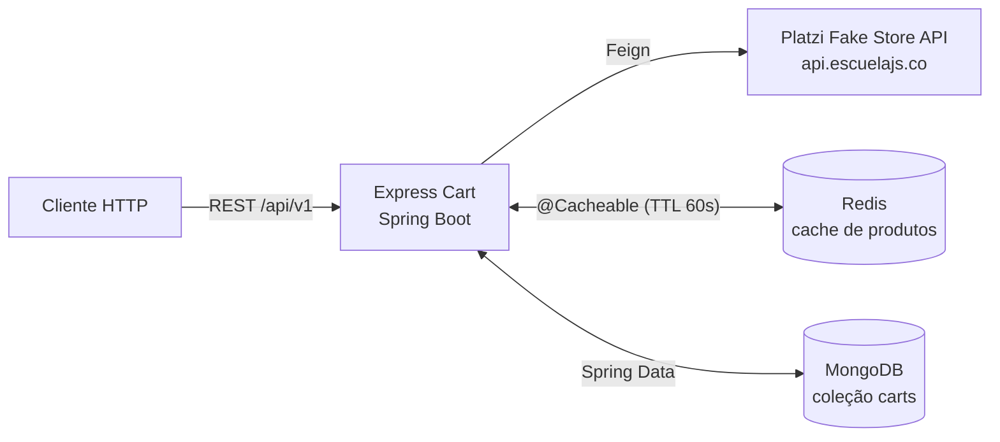
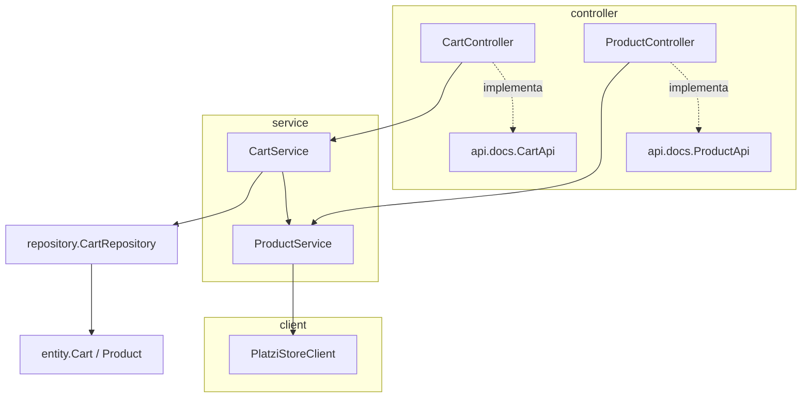
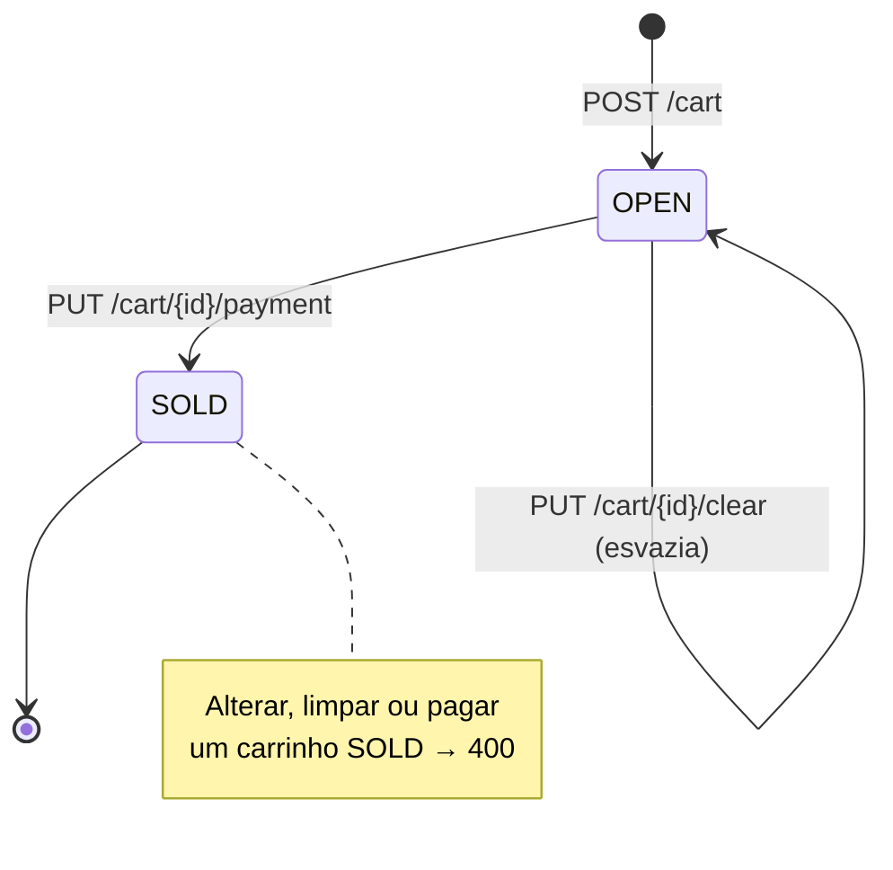
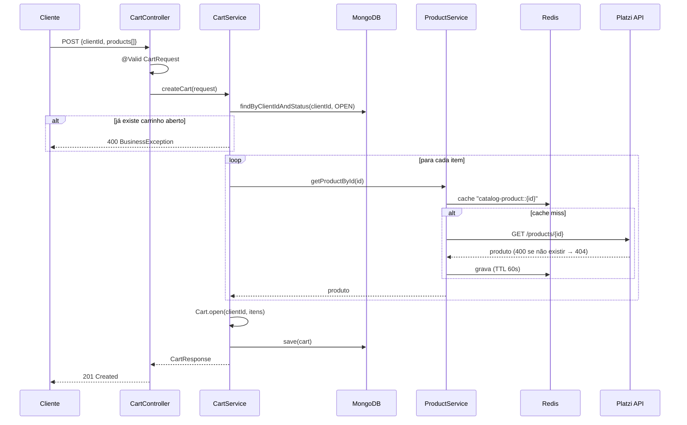

# 📐 Arquitetura do Express Cart

Este documento descreve **como o sistema funciona hoje**: camadas, fluxos, modelo de dados, regras de negócio, contratos HTTP e configuração. Ele serve de referência para a refatoração. Os problemas e melhorias identificados estão em [REFACTORING.md](REFACTORING.md).

---

## 1. Visão geral

O Express Cart é uma API REST (Spring Boot) que gerencia carrinhos de compra. Ele **não tem catálogo próprio**: os produtos vêm da API pública [Platzi Fake Store](https://fakeapi.platzi.com/) e ficam em cache no Redis. Os carrinhos são guardados no MongoDB.



### Stack

| Item | Versão / valor | Onde |
|---|---|---|
| Java | 21 | `pom.xml` (`java.version`) |
| Spring Boot | 3.5.3 | `pom.xml` (parent) |
| Spring Cloud | 2025.0.0 (OpenFeign fixado em 4.2.2) | `pom.xml` |
| springdoc-openapi | 2.8.9 | `pom.xml` |
| MongoDB | imagem `mongo:4` | `docker-compose.yml` |
| Redis | imagem `redis` (sem tag) | `docker-compose.yml` |
| Lombok | gerenciado pelo Boot | `pom.xml` |

---

## 2. Camadas e pacotes



| Pacote | Responsabilidade | Classes |
|---|---|---|
| `controller` | Endpoints REST. Delegam tudo para os services. | `CartController`, `ProductController` |
| `controller.api.docs` | Interfaces só com anotações OpenAPI/Swagger. Os controllers as implementam para manter a documentação fora do código dos endpoints. | `CartApi`, `ProductApi` |
| `controller.request` | DTOs de entrada (records + Bean Validation). O subpacote `validation` tem as validações próprias. | `CartRequest`, `CartUpdateRequest`, `ProductRequest`, `PaymentRequest`, `validation.UniqueProductIds` |
| `controller.response` | DTOs de saída. Nenhuma resposta expõe a entidade nem o modelo da Platzi. | `CartResponse`, `CartItemResponse`, `PaymentResponse`, `ProductResponse`, `CategoryResponse` |
| `service` | Orquestração dos casos de uso do carrinho (`CartService`) e acesso ao catálogo com cache (`ProductService`). | `CartService`, `ProductService` |
| `client` | Cliente Feign da API Platzi e os DTOs de resposta dela. Só o `ProductService` usa este pacote. | `PlatziStoreClient`, `PlatziProductResponse`, `PlatziCategoryResponse` |
| `repository` | Acesso ao MongoDB. | `CartRepository` |
| `entity` | Documento Mongo com as regras de estado do carrinho, e enums de domínio. | `Cart`, `Product`, `Status`, `PaymentMethod` |
| `exception.handler` | Exceções de aplicação (o nome do pacote engana: aqui não há handlers). | `BusinessException`, `DataNotFoundException`, `ExternalServiceException` |
| `exception.response` | Formatos de erro devolvidos ao cliente. | `GenericErrorResponse`, `ValidationErrorResponse` |
| `config` | Handler global de erros e metadados do OpenAPI. | `ControllerAdvice`, `OpenApiConfig` |

---

## 3. Modelo de dados

### `Cart`: documento da coleção `carts` (MongoDB)

| Campo | Tipo | Observação |
|---|---|---|
| `id` | `String` | ObjectId gerado pelo Mongo |
| `clientId` | `Long` | Identificador do cliente (não é validado contra nenhum cadastro) |
| `totalPrice` | `BigDecimal` | Calculado pela própria entidade a cada mudança de itens = Σ(`price` × `quantity`) |
| `products` | `List<Product>` | Itens embutidos no documento |
| `status` | `Status` | `OPEN` ou `SOLD` |
| `paymentMethod` | `PaymentMethod` | `PIX`, `DEBIT` ou `CREDIT`; nulo até o pagamento (omitido no JSON quando nulo) |

A entidade não tem setters. Ela só muda por estes métodos, que aplicam as regras:

| Método | O que faz | Recusa se |
|---|---|---|
| `Cart.open(clientId, itens)` | Cria o carrinho `OPEN` com o total calculado | n/a |
| `replaceItems(itens)` | Substitui os itens e recalcula o total | carrinho `SOLD` |
| `clear()` | Remove os itens e zera o total | carrinho `SOLD` |
| `pay(método)` | Grava o método de pagamento e muda para `SOLD` | carrinho `SOLD` |

### `Product`: item embutido no carrinho

`id`, `title`, `price`, `quantity`. O `title` e o `price` são **copiados da API externa no momento em que o item é adicionado** (é uma cópia do preço naquele instante). Se o preço mudar depois na Platzi, o carrinho não é atualizado até o próximo `PUT`.

### Máquina de estados do carrinho



---

## 4. Regras de negócio

| # | Regra | Onde | Erro |
|---|---|---|---|
| R1 | Um cliente só pode ter **um** carrinho `OPEN` por vez | `createCart` → `findByClientIdAndStatus` | `BusinessException` → 400 |
| R2 | Todo produto do pedido precisa existir na API Platzi | `buildProductListFromRequest` | `DataNotFoundException` → 404 |
| R3 | O total é recalculado sempre que os itens mudam | `Cart` (`open`, `replaceItems`, `clear`) | n/a |
| R4 | Carrinho `SOLD` não pode ser alterado, limpo nem pago de novo | `Cart` (`replaceItems`, `clear`, `pay`) | `BusinessException` → 400 |
| R5 | O `PUT /cart/{id}` **substitui** a lista inteira de itens (não faz merge) | `Cart.replaceItems` | n/a |
| R6 | Quantidade por item: 1 a 100 (na criação e na atualização) | `ProductRequest` (Bean Validation) | 400 (lista de `ValidationErrorResponse`) |
| R8 | Um produto só pode aparecer uma vez na lista de itens (na criação e na atualização) | `@UniqueProductIds` em `CartRequest` e `CartUpdateRequest` | 400 (lista de `ValidationErrorResponse`, campo `products`) |
| R7 | Pagamento exige `paymentMethod` | `PaymentRequest` (Bean Validation) | 400 (lista de `ValidationErrorResponse`) |

> A atualização usa `CartUpdateRequest`, que só tem `products`: o dono do carrinho não muda. Um `clientId` enviado no corpo é ignorado.

---

## 5. Fluxos principais

### Criar carrinho: `POST /api/v1/cart`



### Consultar produtos: `GET /api/v1/product` e `/api/v1/product/{id}`

1. `ProductService` é `@Cacheable` (caches `catalog-products` e `catalog-product`, chave = `id`). O valor em cache é o `ProductResponse`, já convertido.
2. Em cache miss, chama `PlatziStoreClient` (Feign) na URL `expresscart.client.platzi`.
3. O `ProductService` traduz os erros do Feign:
   - `400` (a Platzi responde 400 para ID inexistente) → `DataNotFoundException` → **404** com o id na mensagem.
   - qualquer outra falha (5xx, timeout, conexão) → `ExternalServiceException` → **502**.
4. A lista vazia retorna **204 No Content**.

---

## 6. Contrato HTTP

Base: `http://localhost:8080`. Swagger UI: `/swagger-ui/index.html`. Spec OpenAPI: `/v3/api-docs`.

### Carrinho: `/api/v1/cart`

| Método | Rota | Corpo | Sucesso | Erros |
|---|---|---|---|---|
| `POST` | `/api/v1/cart` | `CartRequest` | `201` `CartResponse` | 400 (validação / carrinho aberto duplicado), 404 (produto), 502 (Platzi) |
| `GET` | `/api/v1/cart/{id}` | n/a | `200` `CartResponse` | 404 (carrinho) |
| `PUT` | `/api/v1/cart/{id}` | `CartUpdateRequest` | `200` `CartResponse` | 400 (validação / carrinho vendido), 404 (carrinho / produto), 502 (Platzi) |
| `PUT` | `/api/v1/cart/{id}/payment` | `PaymentRequest` | `200` `PaymentResponse` | 400 (validação / já pago), 404 (carrinho) |
| `PUT` | `/api/v1/cart/{id}/clear` | n/a | `200` `CartResponse` | 400 (carrinho vendido), 404 (carrinho) |

### Produto: `/api/v1/product`

| Método | Rota | Sucesso | Erros |
|---|---|---|---|
| `GET` | `/api/v1/product` | `200` `ProductResponse[]` ou `204` | 502 |
| `GET` | `/api/v1/product/{id}` | `200` `ProductResponse` | 404, 502 |

### Exemplos de payload

```jsonc
// CartRequest (POST)
{ "clientId": 1, "products": [ { "id": 3, "quantity": 2 } ] }

// CartUpdateRequest (PUT)
{ "products": [ { "id": 3, "quantity": 2 } ] }

// PaymentRequest
{ "paymentMethod": "PIX" }   // PIX | DEBIT | CREDIT

// CartResponse
{ "id": "66cd...", "clientId": 1, "totalPrice": 180.00,
  "products": [ { "id": 3, "title": "...", "price": 90.00, "quantity": 2 } ],
  "status": "OPEN" }

// PaymentResponse
{ "id": "66cd...", "status": "SOLD", "paymentMethod": "PIX" }
```

### Formato dos erros (`config/ControllerAdvice`)

| Exceção | HTTP | Corpo |
|---|---|---|
| `MethodArgumentNotValidException` | 400 | `[{ "field": "...", "message": "..." }]` (lista) |
| `HttpMessageNotReadableException` (JSON inválido, enum ou tipo errado) | 400 | `{ "timestamp", "status", "message" }` |
| `MethodArgumentTypeMismatchException` (ex.: id não numérico na URL) | 400 | idem |
| `HttpMediaTypeNotSupportedException` | 415 | idem |
| `BusinessException` | 400 | `{ "timestamp", "status", "message" }` |
| `DataNotFoundException` | 404 | idem |
| `NoHandlerFoundException` (rota inexistente) | 404 | idem |
| `ExternalServiceException` (falha na Platzi) | 502 | idem |
| `HttpRequestMethodNotSupportedException` | 405 | idem |
| Qualquer outra `Exception` | 500 | idem, com mensagem fixa `"Erro interno da aplicação"`. A exceção vai para o log |

> Erros de validação e erros genéricos têm **formatos diferentes** (lista × objeto).

---

## 7. Configuração

`src/main/resources/application.yml`:

| Propriedade | Valor | Função |
|---|---|---|
| `spring.data.mongodb.host/port/database` | `localhost` / `27017` / `express-cart` | Conexão Mongo |
| `spring.data.redis.host/port/password` | `localhost` / `6379` / `password` | Conexão Redis |
| `spring.cache.redis.time-to-live` | `60000` (ms) | TTL do cache de produtos |
| `spring.mvc.throw-exception-if-no-handler-found` + `spring.web.resources.add-mappings: false` | n/a | Faz rotas inexistentes caírem no `ControllerAdvice` (404 em JSON) |
| `expresscart.client.platzi` | `https://api.escuelajs.co/api/v1` | URL base do Feign |

Não há perfis (`application-*.yml`) nem variáveis de ambiente: tudo está fixo no arquivo.

### Infra local (`docker-compose.yml`)

- `mongo` (`mongo:4`), porta 27017, volume `mongo-data`.
- `redis` (`redis`, sem versão), porta 6379, **sem senha** configurada no container (a variável `ALLOW_EMPTY_PASSWORD` só tem efeito em imagens Bitnami).

---

## 8. Testes

```bash
bash ./mvnw test      # unitários + integração (precisa do Docker rodando)
bash ./mvnw verify    # idem + relatório de cobertura em target/site/jacoco/index.html
```

- **Unitários** (`entity/`, `service/`, `config/`): JUnit 5 + Mockito.
- **Slice web** (`controller/`): `@WebMvcTest`, cobre status HTTP, validação e formato dos erros.
- **Integração** (`integration/`): aplicação completa com MongoDB e Redis reais (Testcontainers) e a API da Platzi simulada com WireMock. Não dependem do `docker-compose` nem de internet.

Os testes são de **caracterização**: registram o comportamento atual, incluindo os bugs listados em [REFACTORING.md](REFACTORING.md).
